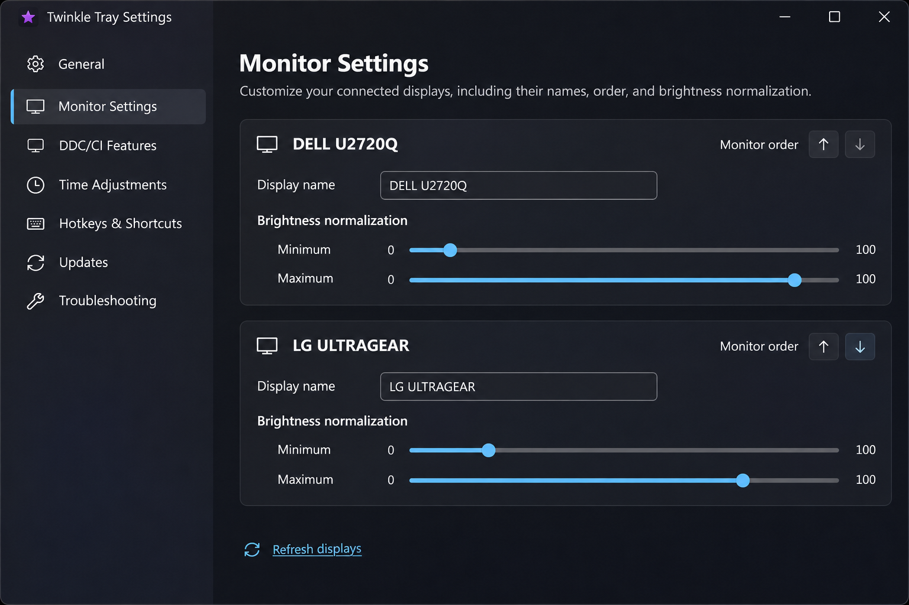
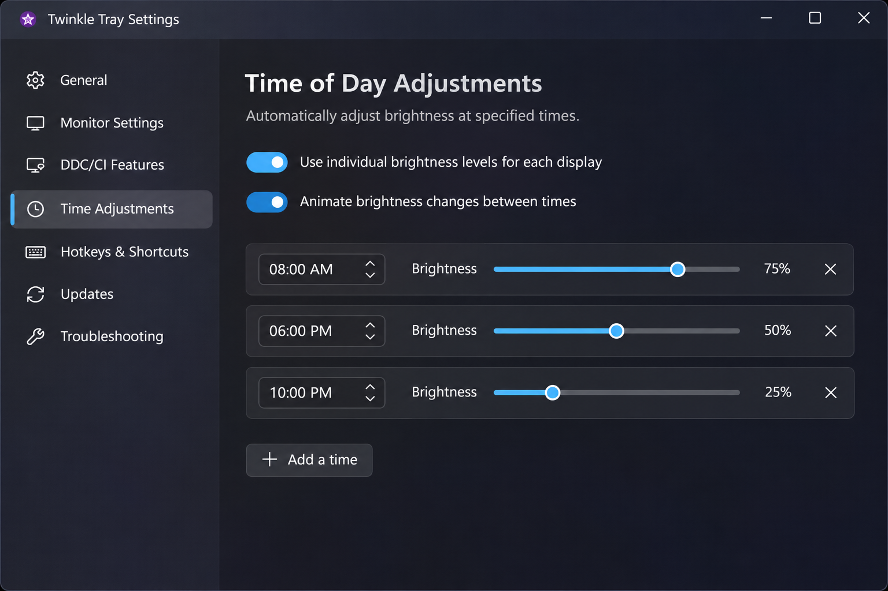
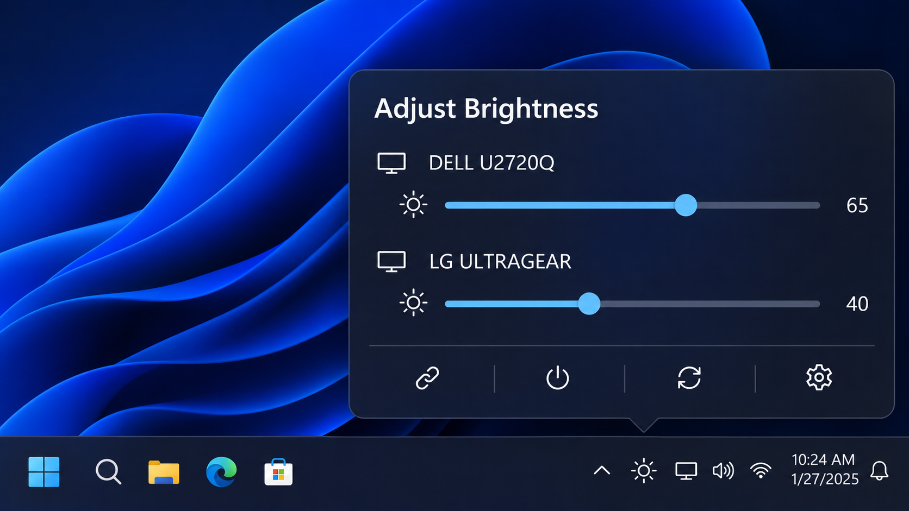

# Twinkle Tray Brightness Slider - Windows Monitor Brightness Control

TwinkleTray is a Windows system-tray application for adjusting internal and external displays individually or together. Twinkle Tray Open Source provides the project home, while Twinkle Tray Brightness Slider delivers quick brightness access without navigating physical monitor menus.

Twinkle Tray Monitor Brightness Control uses Windows display APIs, WMI for compatible internal panels, and DDC/CI for supported external monitors. The retained source is a C# and WPF codebase whose internal project names remain Monitorian for build compatibility.

## Requirements

| Requirement | Details |
|---|---|
| Operating system | Windows 10 or Windows 11 |
| Runtime | .NET Framework 4.8 |
| External displays | DDC/CI must be supported and enabled in the monitor menu |
| Development | Visual Studio with the matching .NET Framework and Windows SDK components |

### What is the brightness control app for Windows 10?

TwinkleTray is a system-tray brightness controller for Windows 10. Twinkle Tray Brightness Slider provides separate controls for compatible displays and can move multiple screens together. Twinkle Tray Open Source includes WPF views, monitor discovery, DDC/CI communication, WMI handling, settings, and display-state watchers.

## Install/Uninstall

Run Twinkle Tray Brightness Slider under a Windows account that can access the connected displays. External monitors may require DDC/CI to be enabled through their physical on-screen menus.

Application settings are maintained per user. Startup behavior and saved monitor identities can depend on the Windows account, connector, dock, cable, and display path. Remove the application through the same package or deployment mechanism used to install it.

## Major features

- Control internal and compatible external display brightness.
- Adjust monitors independently or move several displays together.
- Use DDC/CI for supported external monitors.
- Use WMI for compatible built-in display brightness.
- Track connection, session, power, and display-setting changes.
- Configure monitor ranges and supported contrast controls.
- Present compact WPF sliders from a system-tray workflow.
- Preserve settings for recognized monitor identities.
- Rescan displays after connection or power-state changes.
- Support Twinkle Tray Windows 10 and Twinkle Tray Windows 11 workflows.

| Area | Retained implementation |
|---|---|
| Monitor discovery | [`MonitorManager.cs`](Source/Monitorian.Core/Models/Monitor/MonitorManager.cs) and [`DisplayMonitorProvider.cs`](Source/Monitorian.Core/Models/Monitor/DisplayMonitorProvider.cs) |
| DDC/CI displays | [`DdcMonitorItem.cs`](Source/Monitorian.Core/Models/Monitor/DdcMonitorItem.cs) |
| WMI displays | [`WmiMonitorItem.cs`](Source/Monitorian.Core/Models/Monitor/WmiMonitorItem.cs) |
| Display metadata | [`EdidInfo.cs`](Source/Monitorian.Core/Models/Monitor/EdidInfo.cs) and [`DeviceInformation.cs`](Source/Monitorian.Core/Models/Monitor/DeviceInformation.cs) |
| Power behavior | [`PowerManagement.cs`](Source/Monitorian.Core/Models/Monitor/PowerManagement.cs) and [`PowerWatcher.cs`](Source/Monitorian.Core/Models/Watcher/PowerWatcher.cs) |
| User interface | [`MainWindow.xaml`](Source/Monitorian.Core/Views/MainWindow.xaml) and [`MenuWindow.xaml`](Source/Monitorian.Core/Views/MenuWindow.xaml) |

## Remarks

- Monitor names and saved settings rely on identities supplied by Windows.
- Reconnecting a display through another connector can produce a different identity.
- Docks, converters, graphics drivers, and cables can affect DDC/CI availability.
- A monitor may expose brightness but not contrast, volume, or power controls.
- Hardware brightness changes the monitor backlight, while software dimming changes the rendered image.
- Display detection may take longer when an unreachable monitor remains registered by Windows.

### Where is my brightness slider?

Open TwinkleTray from its system-tray icon to display the per-monitor controls. Twinkle Tray Brightness Slider shows a slider only when the corresponding display is discovered and exposes a compatible brightness interface. If the tray icon or display is missing, verify that the application is running, rescan the displays, and check the DDC/CI or WMI conditions described below.

### Project Terms

twinkle tray open source, twinkle tray brightness slider, twinkle tray monitor brightness control, twinkle tray ddc ci, twinkle tray windows 11, brightness-control, monitor-control, display-control, ddc-ci, multi-monitor, system-tray, windows-11, screen-brightness

## Add-on Features

### Hot keys & Shortcut keys

Twinkle Tray Brightness Hotkeys can provide rapid adjustments without opening the tray panel. A complete hotkey implementation must preserve monitor selection, percentage bounds, and synchronized-display behavior. The retained source selection contains the monitor and settings foundations, but it does not establish every hotkey feature from the complete TwinkleTray distribution.

### Command-line options

Twinkle Tray CLI is intended for scripts that read or change display settings. Commands should identify a monitor explicitly when more than one display is connected and should validate values before issuing DDC/CI or WMI operations. The selected files do not include a complete command-line entry point, so this repository snapshot should not advertise undocumented command syntax.

### Automation

Twinkle Tray Brightness Schedule and Twinkle Tray Idle Screen Dimming describe automation available in the broader application design. Automation must account for session changes, sleep, resume, monitor reconnection, and manual overrides. The retained watchers provide relevant event foundations, including [`SessionWatcher.cs`](Source/Monitorian.Core/Models/Watcher/SessionWatcher.cs), [`TimerWatcher.cs`](Source/Monitorian.Core/Models/Watcher/TimerWatcher.cs), and [`BrightnessWatcher.cs`](Source/Monitorian.Core/Models/Watcher/BrightnessWatcher.cs).

## Detection of external monitors

Twinkle Tray External Monitor Brightness depends on successful DDC/CI communication. Twinkle Tray DDC CI detection examines connected display information and determines whether a monitor can expose controllable settings.

A display may remain unavailable for any of these reasons:

1. The monitor does not implement DDC/CI.
2. The monitor has DDC/CI disabled in its on-screen menu.
3. The graphics connector does not forward DDC/CI traffic.
4. The cable, converter, docking station, or KVM blocks communication.
5. The display returns incomplete or incorrect capability information.
6. The monitor is asleep, disconnected, or temporarily unreachable.
7. Windows has retained stale display information after a topology change.

### Why is my brightness slider greyed out?

A greyed-out control usually means TwinkleTray discovered the display but cannot currently write its brightness value. Enable DDC/CI in the external monitor menu, update the graphics driver, reconnect the display, and request another scan. For an internal panel, confirm that Windows exposes WMI brightness control and that another display utility is not holding the interface.

Twinkle Tray Disabled Native Brightness Slider can also describe a Windows state change rather than a deliberate application action. Restarting the display driver or Windows may restore the native control, but the underlying cause should be verified before attributing it to Twinkle Tray Brightness Slider.

## Supported displays

- Compatible laptop and all-in-one panels exposed through WMI.
- External monitors implementing DDC/CI brightness controls.
- Multi-monitor arrangements in which each display has its own capabilities.
- Displays with optional contrast and power-related VCP features.
- HDR displays represented by [`HdrMonitorItem.cs`](Source/Monitorian.Core/Models/Monitor/HdrMonitorItem.cs).

Televisions, virtual displays, wireless displays, and some DisplayLink paths may not provide hardware brightness control. Unsupported displays must not be treated as controllable merely because Windows reports them as connected.

## Development

Twinkle Tray Open Source uses C#, WPF, XAML, and Windows display APIs. The main solution is [`Source/Monitorian.sln`](Source/Monitorian.sln), with application and core projects defined by [`Monitorian.csproj`](Source/Monitorian/Monitorian.csproj) and [`Monitorian.Core.csproj`](Source/Monitorian.Core/Monitorian.Core.csproj).

The retained code separates display models, watchers, view models, controls, and WPF views. Twinkle Tray Brightness Slider should preserve that separation when adding monitor protocols or user-interface behavior.

### Reporting

A useful display report should include:

- The Windows version and graphics adapter.
- The monitor manufacturer and model.
- The connection type, cable, converter, dock, or KVM.
- Whether DDC/CI is enabled in the monitor menu.
- Whether the display was connected during startup or resume.
- Whether rescanning changes the result.
- Whether brightness works through Windows or another trusted controller.

Do not publish private system information without reviewing diagnostic output.

### Probe

Monitor discovery is coordinated through the monitor providers and manager. Diagnostic work should distinguish an absent display, an unreachable display, and a detected display without writable brightness support. [`UnreachableMonitorItem.cs`](Source/Monitorian.Core/Models/Monitor/UnreachableMonitorItem.cs) represents the unreachable state explicitly.

### Rescan

A rescan should follow monitor connection, removal, resume, graphics-driver reset, or display-topology changes. Repeated scans should avoid overlapping hardware operations and should preserve valid settings for unchanged monitor identities.

### Operations

Operation logging should record discovery and state transitions without exposing unnecessary personal data. [`OperationRecorder.cs`](Source/Monitorian.Core/Models/OperationRecorder.cs) and [`Logger.cs`](Source/Monitorian.Core/Models/Logger.cs) provide the retained logging foundations.

### Exceptions

Unexpected failures should preserve enough context to distinguish DDC/CI transport errors, WMI failures, malformed display data, unreachable devices, and user-interface errors. Exception formatting support is retained in [`ExceptionExtension.cs`](Source/Monitorian.Core/Helper/ExceptionExtension.cs).

### Setup

1. Install Visual Studio with .NET Framework 4.8 development support.
2. Install a Windows 10 or Windows 11 SDK compatible with the project.
3. Open [`Source/Monitorian.sln`](Source/Monitorian.sln).
4. Restore the required packages.
5. Select the appropriate build configuration.
6. Build the solution and review any missing dependencies before running it.

The selected file set is curated and may not contain every asset, localization, installer component, or auxiliary project from its original source. Build failures caused by absent referenced resources must be resolved explicitly rather than hidden.

### I have a missing brightness bar in Windows 11. How can I fix it?

First determine whether the missing control is the Windows brightness bar or the TwinkleTray tray control. Windows often hides its native brightness bar for external monitors because it does not expose them through the same interface as an internal panel. Twinkle Tray Windows 11 can control compatible external displays through DDC/CI even when the native Windows bar is absent.

If Twinkle Tray Brightness Slider also lacks the display, enable DDC/CI, reconnect the cable, update the graphics driver, restart TwinkleTray, and rescan. A dock or adapter that blocks DDC/CI may need to be bypassed for testing.

## Troubleshooting

### External monitor is not detected

Confirm that the monitor supports DDC/CI and that the setting is enabled. Test a direct HDMI, DisplayPort, or USB-C connection where possible. Remove converters or docks temporarily and compare detection results.

### Brightness changes fail after resume

Wait for the display to wake fully, then rescan. Power and session events can arrive before a monitor is ready to accept DDC/CI commands. Twinkle Tray Monitor Power Control must treat temporary communication failures differently from permanent incompatibility.

### Monitors have uneven brightness

Equal percentage values do not guarantee equal perceived luminance across different models. Twinkle Tray Backlight Normalization can compensate for those differences when suitable calibration data is available. Hardware limits and panel characteristics still determine the final result.

## History

The retained architecture reflects ongoing work in monitor discovery, Windows compatibility, DDC/CI handling, WMI handling, display watchers, slider behavior, and multi-monitor state management. Project-specific release changes belong in [`CHANGELOG.md`](CHANGELOG.md).

## License

See [`LICENSE.md`](LICENSE.md).

## Libraries

The application uses the .NET Framework, WPF, XAML, Windows monitor APIs, WMI, and DDC/CI-facing Windows interfaces. Dependency and build configuration are represented by [`Source/Directory.Build.props`](Source/Directory.Build.props) and the project files.

## Contributing to the project

Keep changes focused and place reusable behavior in the appropriate model, helper, watcher, view-model, or control. Validate multi-monitor behavior, disconnected displays, sleep and resume, percentage boundaries, and unsupported features. Report security-sensitive findings according to [`SECURITY.md`](SECURITY.md).

## Credits

Twinkle Tray Open Source incorporates design lessons from Windows tray controllers, WPF monitor utilities, DDC/CI command-line programs, native display controllers, protocol parsers, monitor-database tools, and cross-platform screen dimmers. Twinkle Tray Brightness Slider applies those ideas to a focused Windows system-tray experience.
